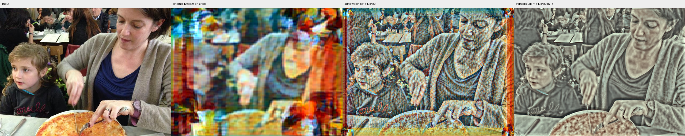

# Rain：640×480 整图教师与裁块训练试验

2026-10-20。已完成主机试验：640×480 整图生成教师结果，抽取对齐的 256×256 小块训练，再导出固定 640×480 INT8 学生模型。分别训练 1200 步和 6000 步，使用同一组 32 张独立验证图。

**流程跑通，但本次小学生的画质不足以替换当前模型。** 延长训练后轮廓有所改善，颜色和细密风格仍明显丢失。同权重的 640×480 Rain 能保留更多内容，但常量黑白输入仍出现彩色边界纹理；放大推理尺寸没有消除这些伪影。这是模型输出对照，不能作为 HDMI 雪花或冻结块已解决的证据。

## 模型来源与区别

- 原 Rain Princess TFLite 保持原样，SHA256：`26852af8672516371f19b05e0dcd06ba6c533c13d9cc78fcf2b65b3f838729c5`。
- 独立教师副本只改变激活张量空间尺寸及两处固定 Resize 尺寸；保留 16 Conv、5 Add、2 Resize 的结构，以及所有权重、偏置和量化参数。恢复至 128×128 后，文件与原模型逐字节相同。
- 教师副本 SHA256：`6a2fd90bf5357698b0b21e6fc372faf1b129f11d9e0705ff4e47dd92d8e3f61e`。
- **学生是另外训练的新网络**，采用已有 `c448_lowdec_skip_r0`：6 Conv、2 Add、2 Resize，通道 4/4/8。它不等于原 Rain 的完整网络，权重也由本次训练产生。
- 最终学生输入和输出均为 INT8 NHWC `[1,480,640,3]`，文件 5832 字节，SHA256：`6ea1b519faf2a408ec0d4680f4b3e1a0ae6044834d72ba1f8add7249a2269b7b`。
- 未找到云端原始训练工程、浮点检查点和风格训练损失；本次使用现有量化 TFLite 直接生成教师目标，属于蒸馏试验。

## 数据与训练

使用旧方案同一份公开 COCO128 数据，来源为 [Ultralytics COCO128](https://github.com/ultralytics/assets/releases/download/v0.0.0/coco128.zip)。归档 SHA256 保存在 `data-manifest.json`。固定 80 张训练、16 张校准、32 张验证，各集合的文件哈希互不相交。

每张图中心裁为 4:3 并调整为 640×480；通过 TFLite BUILTIN_REF 生成完整教师目标。训练从图像和目标的相同位置裁取 256×256 小块，起点按 4 像素对齐。边界 16 像素不计入训练损失，以减少裁块上下文与整图不同的影响。损失为 L1 加水平/垂直梯度差，使用随机水平翻转、Adam、batch=4、seed=20261020。学习率前 70% 步数为 0.001，后 30% 为 0.0002。

两轮均从相同种子重新初始化学生，使用 CPU；训练耗时分别约 55.5 秒和 276.5 秒，不含数据准备、导出和验证。

## 验证结果

| 训练步数 | 学生 INT8 对教师 PSNR | 学生 INT8 对教师局部 SSIM | 学生浮点与 INT8 PSNR |
|---|---:|---:|---:|
| 1200 | 15.746 dB | 0.3829 | 42.046 dB |
| 6000 | 16.298 dB | 0.4670 | 47.968 dB |

数字为 32 张验证图各自指标的平均值。PSNR 与 SSIM 在这里衡量对现有教师的逼近程度，并不直接衡量风格质量。学生浮点和 INT8 的差异较小，而学生与教师差异仍大；本次主要误差出现在训练拟合阶段。

6000 步导出前检查 BN 折叠最大绝对误差为 0.000244141。输入量化参数为 scale=1、zero point=-128；输出为 scale=1.5150625705718994、zero point=-101。输出量化参数与原 Rain 不同，不能直接沿用原显示反量化常数。

### 对照图

下图从左至右：输入、原 128×128 Rain 输出放大、同权重 640×480 Rain 教师、6000 步学生 INT8 输出。前三张图来自未参与训练和校准的验证集。



[验证图 1](validation-1.png) · [验证图 2](validation-2.png)

常量输入对照从左至右：输入、640 教师、640 学生。

[纯黑输入](black.png) · [纯白输入](white.png)

## 硬件范围

本次完成的是主机训练与推理验证，没有加载 FPGA 位流、固件或模型到板上。

同权重 640 教师每帧卷积计算量为 2,786,918,400 MAC，是原 128 模型的 18.75 倍；学生为 70,041,600 MAC。当前 Rain 后端的编译检查会拒绝两份 640 模型。学生还使用 4 通道卷积和 1×1 最后一层，这些也不在当前专用后端的支持集合内。计算量降低不等于已经验证板端速度。

## 产物与复现

- [独立教师模型](rain_princess_same_weights_640x480_int8.tflite)
- [6000 步学生模型](rain_student_c448_6000_640x480_int8.tflite) 与 [检查点](student-6000.pt)
- [汇总与哈希](summary.json)、[1200 步评估](evaluation-1200.json)、[6000 步评估](evaluation-6000.json)
- [导出契约](export-6000.json)、[教师尺寸修改记录](teacher-resize.json)、[结构与后端检查](structure-checks.json)
- [数据划分](data-manifest.json)、[环境版本](requirements.lock)、[6000 步训练日志](training-6000.jsonl)
- 新增脚本：`one_last_kiss_style/resize_rain.py` 和 `one_last_kiss_style/rain640_trial.py`。已有训练脚本、正式模型和部署代码保持原样。

本机隔离 Python 环境位于 `one_last_kiss_style/build/rain640_trial/venv`。数据归档保存在 `one_last_kiss_style/data/coco128.zip`。从 `dev/fastnst` 执行以下命令，输出目录必须为新的目录：

```bash
IRIS_RAIN_PY=one_last_kiss_style/build/rain640_trial/venv/bin/python
IRIS_RAIN_OUT=one_last_kiss_style/build/rain640_reproduction
"$IRIS_RAIN_PY" one_last_kiss_style/resize_rain.py   --output "$IRIS_RAIN_OUT/teacher/rain_princess_640x480_int8.tflite"
"$IRIS_RAIN_PY" one_last_kiss_style/rain640_trial.py prepare --output "$IRIS_RAIN_OUT"
"$IRIS_RAIN_PY" one_last_kiss_style/rain640_trial.py train   --output "$IRIS_RAIN_OUT" --steps 6000 --patch 256 --batch 4
"$IRIS_RAIN_PY" one_last_kiss_style/rain640_trial.py export --output "$IRIS_RAIN_OUT"
"$IRIS_RAIN_PY" one_last_kiss_style/rain640_trial.py evaluate --output "$IRIS_RAIN_OUT"
```

依赖精确版本保存在锁文件中；PyTorch 为官方 CPU wheel `2.5.1+cpu`。已有教师缓存和两轮完整运行产物仍保存在忽略的 `one_last_kiss_style/build/rain640_trial*` 目录。
